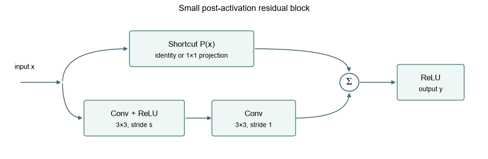
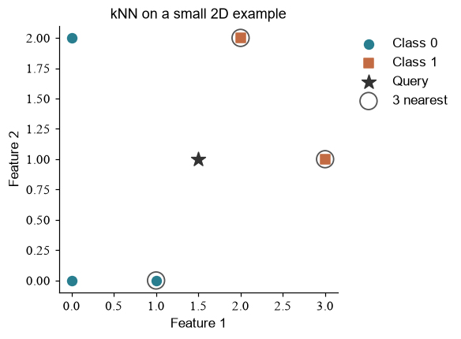
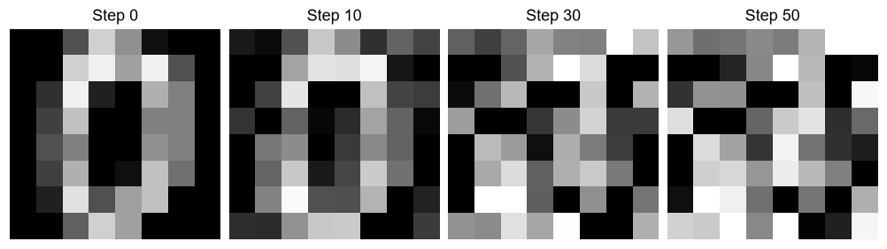
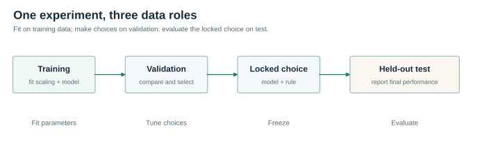

# From Python to Neural Networks

<div align="center">


**Learn by calculating, building, and experimenting.**<br>
从 Python 到神经网络：从一行代码出发，亲手理解模型如何学习。

[中文](README.md) · **English** · [Get started](#get-started) · [Course map](#course-map) · [Interactive lab](https://lee-eee-eee.github.io/neural-networks-from-zero/interactive/) · [Projects](docs/PROJECTS.md)

**24 notebooks** · **139 exercises** · **18 interactive lessons** · **CPU-friendly examples**

</div>

---

Learn how models work by following the numbers: calculate a gradient, implement a small network, and compare models in an experiment. The course moves from Python and classical machine learning to CNNs, sequence models, a tiny character GPT, graphs, and a one-dimensional diffusion example.

Each lesson pairs explanations and code with fill-in exercises and feedback. The interactive lab lets you change a weight or follow a gradient before writing the corresponding code. The classical ML lessons combine worked calculations with scikit-learn models.

> **Language:** Notebook explanations are primarily in Chinese. This guide, the [project briefs](docs/PROJECTS.md), [reference sheet](docs/REFERENCE.md), and lesson 19 provide English navigation or bilingual material.

**Choose an entry point:**

- **New to the course?** [Set up the environment](#get-started) and start with [lesson 00](lessons/python_math/00_start_and_environment.ipynb).
- **Want to explore first?** [Open the interactive lab](https://lee-eee-eee.github.io/neural-networks-from-zero/interactive/) and change a connection weight.
- **Looking for a topic?** Jump to the [course map](#course-map) and choose a module.

## Get started

### 1. Get the course

Install [Git](https://git-scm.com/install/) and [uv](https://docs.astral.sh/uv/getting-started/installation/), then open a terminal:

```bash
git clone https://github.com/Lee-Eee-Eee/neural-networks-from-zero.git
cd neural-networks-from-zero
```

If you already have the folder, open a terminal in its root instead.

### 2. Set up the environment and launch Jupyter

```bash
uv sync --locked
uv run jupyter lab
```

The project specifies **Python 3.12** and CPU PyTorch. `uv sync --locked` installs the dependencies recorded in `uv.lock` into the project environment; `uv run` runs commands using that environment. The first setup may take time while packages are downloaded.

Open `lessons/python_math/00_start_and_environment.ipynb` in JupyterLab. If prompted for a kernel, select the Python environment associated with this project. To check the interpreter from a terminal:

```bash
uv run python -c "import sys; print(sys.executable)"
```

The path should point into the project's `.venv`: typically `.venv\Scripts\python.exe` on Windows or `.venv/bin/python` on macOS/Linux. The introductory experiments use generated data, scikit-learn's bundled digits dataset, and a small course corpus. Lesson 20 also includes an optional MNIST download; the built-in 8×8 digits dataset and 28×28 MNIST are distinct.

## Explore the course

- [What you will learn](#what-you-will-learn) · [Learning paths](#learning-paths) · [Course map](#course-map)
- [Interactive lab](#interactive-lab) · [Get started](#get-started) · [How to work through a lesson](#how-to-work-through-a-lesson)
- [Project work](#project-work) · [Troubleshooting](#troubleshooting) · [Repository and maintenance](#repository-and-maintenance) · [Acknowledgments](#acknowledgments)

## What you will learn

| Practice | What you will do |
| --- | --- |
| **Read and write the computation** | Use Python, NumPy, and PyTorch; label tensor axes; trace individual values through a model. |
| **Understand learning** | Apply the chain rule, write a small network's backward pass, and compare gradients with numerical checks and autograd. |
| **Explore classical ML** | Compare kNN, logistic regression, SVM and clustering; use MSE, Ridge and LASSO on a continuous regression task. |
| **Build models** | Work from sliding windows to CNNs, from recurrent states to LSTMs, and from Q/K/V to a small character GPT; explore GCNs and liquid time-constant networks. |
| **Evaluate and investigate** | Compare against baselines, separate training, validation, and test data, inspect errors, and repeat experiments with different seeds. |
| **Read original work** | Connect an implementation to selected papers, official documentation, and a local minGPT source snapshot. |

The opening lessons introduce Python as they go. Curiosity and a willingness to run and change code are enough to start; algebra and derivatives become useful when you reach the neural-network lessons. Experienced Python users can skim 01–03 and begin with 04, returning to the earlier lessons whenever a shape or operation needs review.

## Learning paths


The diagram is a conceptual learning map. In text: **Python and mathematics → derivatives and training → choose classical ML, vision, sequences, language models, or other networks → experiments**. Lessons 20–23 are numbered after the original sequence but can be taken after the foundations.

- **New to Python?** Start at [00](lessons/python_math/00_start_and_environment.ipynb) and follow 01–07 in order.
- **Interested in classical ML?** After 03 and 06–07, continue with 20–21.
- **Interested in language models?** Complete the foundations, then follow 12–15.
- **Interested in images?** Continue with 08–09, then 23 and the digit-recognition project.
- **Ready to investigate?** Use 18 for experiment design and 19 for classification metrics; each can be revisited alongside a model project.

## Course map

Open a module to see its lessons and what you will practice. Lesson numbers remain stable across modules.

<details>
<summary><strong>Python and mathematics · python_math/</strong></summary>

| Lesson | Topic | Practice |
| :---: | :--- | :--- |
| [00](lessons/python_math/00_start_and_environment.ipynb) | Getting started | Run a first program and use exercise checks |
| [01](lessons/python_math/01_python_values_control.ipynb) | Python values and control flow | Process measurements with variables, lists and loops |
| [02](lessons/python_math/02_python_functions_files_classes.ipynb) | Functions, files and classes | Organize reusable computations and data input/output |
| [03](lessons/python_math/03_numpy_shapes_linear_algebra.ipynb) | NumPy and linear algebra | Use shapes, broadcasting and matrix multiplication |

</details>

<details>
<summary><strong>Neural-network foundations · neural_network_basics/</strong></summary>

| Lesson | Topic | Practice |
| :---: | :--- | :--- |
| [04](lessons/neural_network_basics/04_derivatives_numpy_mlp.ipynb) | Derivatives and a NumPy MLP | Derive backpropagation and train XOR |
| [05](lessons/neural_network_basics/05_torch_tensors_autograd.ipynb) | Tensors and autograd | Trace computation graphs and check gradients |
| [06](lessons/neural_network_basics/06_modules_data_training.ipynb) | Modules, data and training | Connect batches, loss, gradients and updates |
| [07](lessons/neural_network_basics/07_mlp_regression_classification.ipynb) | Regression and classification | Compare baselines and an MLP using validation |

</details>

<details>
<summary><strong>Classical machine learning · classical_ml/</strong></summary>

| Lesson | Topic | Practice |
| :---: | :--- | :--- |
| [20](lessons/classical_ml/20_classical_classification.ipynb) | Classical classification and clustering | Compare kNN, logistic regression, linear SVM and k-means |
| [21](lessons/classical_ml/21_regression_regularization.ipynb) | MSE, Ridge and LASSO | Study regression and regularization with continuous targets |

</details>

<details>
<summary><strong>Computer vision · computer_vision/</strong></summary>

| Lesson | Topic | Practice |
| :---: | :--- | :--- |
| [08](lessons/computer_vision/08_convolution_from_windows.ipynb) | Convolution from windows | Calculate convolution and explain shared weights |
| [09](lessons/computer_vision/09_cnn_training_and_residuals.ipynb) | CNNs and residuals | Train digit classifiers and track residual gradients |
| [23](lessons/computer_vision/23_resnet_from_blocks.ipynb) | A small ResNet | Train a residual classifier and compare it with a plain CNN |

</details>

<details>
<summary><strong>Sequence models · sequence_models/</strong></summary>

| Lesson | Topic | Practice |
| :---: | :--- | :--- |
| [10](lessons/sequence_models/10_rnn_time_and_bptt.ipynb) | RNNs and backpropagation through time | Unroll state updates and shared-parameter gradients |
| [11](lessons/sequence_models/11_lstm_gates_and_memory.ipynb) | LSTM gates and memory | Implement gates and compare with PyTorch |

</details>

<details>
<summary><strong>Language models · llm/</strong></summary>

| Lesson | Topic | Practice |
| :---: | :--- | :--- |
| [12](lessons/llm/12_attention_qkv.ipynb) | Q, K, V and causal attention | Calculate attention and test the causal mask |
| [13](lessons/llm/13_transformer_block.ipynb) | Transformer block | Assemble attention, normalization and residuals |
| [14](lessons/llm/14_small_gpt_training.ipynb) | Tiny character GPT | Train, generate and save a decoder |
| [15](lessons/llm/15_mingpt_reading_and_generation.ipynb) | Reading minGPT | Trace tensors and training through source code |

</details>

<details>
<summary><strong>Graphs, continuous time and generation · other_networks/</strong></summary>

| Lesson | Topic | Practice |
| :---: | :--- | :--- |
| [16](lessons/other_networks/16_gnn_message_passing.ipynb) | Graph neural networks | Aggregate neighbors and train a GCN |
| [17](lessons/other_networks/17_liquid_neural_networks.ipynb) | Liquid neural networks | Build a trainable LTC from continuous dynamics |
| [22](lessons/other_networks/22_diffusion_from_noise.ipynb) | Introduction to diffusion | Visualize image noise; train and sample a 1D model |

</details>

<details>
<summary><strong>Experiments and evaluation · experiments/</strong></summary>

| Lesson | Topic | Practice |
| :---: | :--- | :--- |
| [18](lessons/experiments/18_research_experiments.ipynb) | Research experiments | Compare controls and seeds; analyze extrapolation |
| [19](lessons/experiments/19_evaluation_and_decisions.ipynb) | Classification evaluation | Select a threshold on validation data |

</details>

## Inside the notebooks

The lessons combine diagrams, calculations, executable code, and exercises. This residual block appears in [lesson 23](lessons/computer_vision/23_resnet_from_blocks.ipynb), where you follow both paths and train a small classifier.



<details>
<summary><strong>See two more worked examples</strong></summary>



**kNN:** compare distances and neighbor votes before applying classifiers to handwritten digits in [lesson 20](lessons/classical_ml/20_classical_classification.ipynb).



**Diffusion:** inspect a noise schedule on a digit before training a one-dimensional noise predictor in [lesson 22](lessons/other_networks/22_diffusion_from_noise.ipynb).

</details>

## Interactive lab

The [online lab](https://lee-eee-eee.github.io/neural-networks-from-zero/interactive/) contains 18 browser lessons. Change a value, follow the computation, then reproduce the relevant operation in a notebook. For offline use, open [interactive/index.html](interactive/index.html) or the [standalone HTML file](interactive/neural-network-lab.html).

| When studying | Open | Look for |
| --- | --- | --- |
| 04 | [Network computation](interactive/index.html#network) | How inputs and weights combine at a node. |
| 04–05 | [Backpropagation](interactive/index.html#backprop) | How local derivatives carry a gradient along each edge. |
| 06 | [Shared weights](interactive/index.html#matrix) | How contributions from multiple examples combine. |
| 07 | [Training](interactive/index.html#training) | How the loss and classification boundary change together. |
| 08 | [Convolution](interactive/index.html#convolution) | Which image pixels contribute to a particular output. |
| 09 and 13 | [Residual connections](interactive/index.html#residual) | How a gradient splits at addition and merges at a shared input. |

## How to work through a lesson

1. **Read the opening question.** Before running a cell, predict the result or draw the relevant shapes.
2. **Run the notebook in order.** Earlier cells define names that later cells use; read both the code and its output.
3. **Fill in each exercise.** Replace the placeholder in the exercise cell, then run the following check cell. Expand the hint and reference answer when you need them.
4. **Change one condition.** Modify a value or setting, rerun the relevant cells, and explain the observed change using the computation.
5. **Keep an experiment record.** Note your question, data split, settings, seed, results, and an error or observation worth investigating.

The notebooks include saved example outputs. Your own changes are saved in your local notebook. Restart the kernel and run from the beginning when earlier state may have become inconsistent.

## Project work



The diagram shows the roles of data in one experiment: fit on training data, select on validation, then evaluate the locked choice on test data.

After the foundation lessons, choose a [bilingual project brief](docs/PROJECTS.md). Each brief specifies prerequisites, a question, a first experiment, and an extension:

| Project | Central question | Suggested preparation |
| --- | --- | --- |
| **Digit recognition** | How do MLP and CNN errors differ on the same data? | 03, 06–09 |
| **Rare-event screening** | Does high accuracy mean rare positive cases are found? | 07, 18–19 |
| **Character prediction** | How does context length affect prediction and generation? | 12–14 |
| **Graph neighbors** | What happens when nodes are relabeled or edges change? | 03, 16, 18 |

For each project, compare against a baseline where appropriate, use validation data for choices, and report the held-out test result after those choices. The [bilingual reference sheet](docs/REFERENCE.md) collects notation, common shapes, the training loop, and debugging prompts.

## Troubleshooting

<details>
<summary><strong>The notebook uses a different Python or cannot import a dependency</strong></summary>

Run `uv sync --locked` from the repository root and launch Jupyter with `uv run jupyter lab`. Compare the notebook's Python with `uv run python -c "import sys; print(sys.executable)"`, then select the project environment as the kernel and restart it.

</details>

<details>
<summary><strong>A cell reports <code>NameError</code> or an unexpected value</strong></summary>

Notebook cells share state. Restart the kernel and run cells from the top in order; check that the exercise cell was filled and run before its check cell.

</details>

<details>
<summary><strong>A tensor operation reports a shape mismatch</strong></summary>

Print the `.shape` of each operand, label the sample, sequence, channel, or feature axes, and compare them with the operation's requirements. The [reference sheet](docs/REFERENCE.md) has common shape conventions.

</details>

## Repository and maintenance

```text
lessons/python_math/             Python and mathematics
lessons/neural_network_basics/   Derivatives, MLP and training
lessons/classical_ml/            Classical algorithms and regularization
lessons/computer_vision/         CNNs and small residual networks
lessons/sequence_models/         RNNs and LSTMs
lessons/llm/                     Attention, Transformers and GPT
lessons/other_networks/          GNN, LTC and diffusion
lessons/experiments/             Experimental design and evaluation
interactive/         Browser lab, standalone page and local MathJax assets
models/              Reusable tiny GPT model
```

| Path | Purpose |
| --- | --- |
| [`docs/`](docs/) | Bilingual project briefs and reference sheet. |
| [`tools/chapters/`](tools/chapters/) | Source used to generate notebook content. |
| [`tools/`](tools/) | Course generation, execution, and validation scripts. |
| [`references/`](references/) | Source map, teaching notes, and local minGPT snapshot. |
| [`support.py`](support.py) | Exercise feedback and figure helpers. |
| [`course_manifest.json`](course_manifest.json) | Lesson names, paths, cell counts, and exercise counts. |

Run the course checks from the repository root:

```bash
uv run python tools/validate_course.py
node tools/check_interactive.cjs
```

To regenerate the README preview images from the saved notebook outputs, run `uv run python tools/export_readme_previews.py`.

To execute one lesson and save its outputs, run:

```bash
uv run python -B tools/execute_course.py --pattern '01*.ipynb' --jobs 1
```

This writes back to the selected notebook. Add `--answers` to execute reference solutions into `.build/` instead. `uv run python tools/build_course.py` rebuilds notebooks from their sources: filled exercise answers are preserved, while notebook prose and other code cells are rebuilt. Edit the corresponding file in `tools/chapters/` when maintaining lesson content.

## Acknowledgments

Thank you to the authors and maintainers of these open resources for the ideas, explanations, and implementations that support this course:

- [Build Your Own X: Machine Learning](https://github.com/amitshekhariitbhu/build-your-own-x-machine-learning) for its collection of hands-on machine-learning projects and tutorials.
- [Andrej Karpathy's micrograd](https://github.com/karpathy/micrograd) and [minGPT](https://github.com/karpathy/minGPT) for approachable computation-graph and language-model implementations; lesson 15 reads a local minGPT snapshot.
- [Dive into Deep Learning](https://github.com/d2l-ai/d2l-en), [Machine Learning with PyTorch and Scikit-Learn](https://github.com/rasbt/machine-learning-book), and [ML From Scratch](https://github.com/eriklindernoren/ML-From-Scratch) for accessible ways to connect explanation, code, and experiments.
- [Happy-LLM](https://github.com/datawhalechina/happy-llm) and the [DDPM paper](https://arxiv.org/abs/2006.11239) for further language-model reading and diffusion principles.
- The developers of [MathJax](https://www.mathjax.org/) for the mathematics display in the interactive lab.
- The authors of [PyTorch's tutorials](https://docs.pytorch.org/tutorials/beginner/basics/intro.html), [Attention Is All You Need](https://arxiv.org/abs/1706.03762), [GCN](https://arxiv.org/abs/1609.02907), and [Liquid Time-constant Networks](https://arxiv.org/abs/2006.04439), whose work provides further reading throughout the course.

See [course design and references](docs/COURSE_DESIGN.md) for how external ideas are adapted into the course’s own examples. See the [source map](references/SOURCES.md) and [teaching notes](references/TEACHING_NOTES.md) for reading questions and teaching references, and [third-party notices](THIRD_PARTY.md) for included materials and their licenses.
