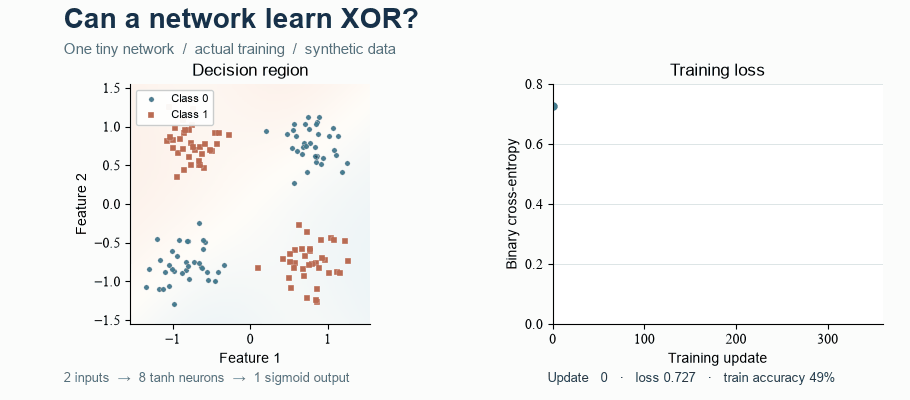
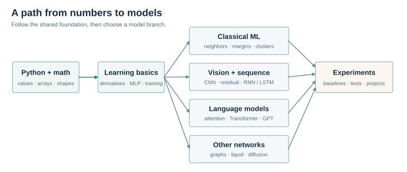

# Everybody Digs ML

<div align="center">


**从一行 Python 出发，亲手理解机器如何学习。**

[English](README.en.md) · [立即体验](#先动手再弄懂) · [学习路线](#学习路线) · [课程目录](#课程目录) · [开始学习](#开始学习) · [致谢](#致谢)

`24 个 Notebook`　 `139 道练习`　 `18 节交互实验`　 `Python 3.12 · CPU`

</div>

---

一个模型为什么会认错数字？训练时，权重究竟往哪个方向改变？生成文本时，每个字符又是怎样被选出来的？

这是一套把**公式、代码和实验**放在一起的机器学习教程：先手算一个小问题，再把它写成程序，最后改变条件，观察结果。课程从 Python 与 NumPy 出发，经过经典机器学习和神经网络，走向 Transformer、微型 GPT、图网络与扩散模型。

> **先预测 → 再运行 → 改一点 → 解释发生了什么。**

Notebook 正文以中文为主；[English guide](README.en.md)提供英文导航，[项目指南](docs/PROJECTS.md)和[速查表](docs/REFERENCE.md)为中英双语。

## 先动手，再弄懂

<p align="center">
  <a href="https://lee-eee-eee.github.io/everybody-digs-ml-lab/interactive/#network"></a>
</p>

<p align="center"><sub>动图展示一个独立 NumPy 小网络在合成 XOR 数据上的训练过程。<br><a href="https://lee-eee-eee.github.io/everybody-digs-ml-lab/interactive/">打开浏览器交互学习室 →</a></sub></p>

**试一个问题：把一条权重调大，输出一定会变吗？**

1. [打开神经网络实验](https://lee-eee-eee.github.io/everybody-digs-ml-lab/interactive/#network)。把输入 `x₁` 设为 `0.6`，拖动 `w₁₁`，观察隐藏节点和输出。
2. 把 `x₁` 设为 `0`，再次拖动 `w₁₁`。保持其他设置不变，这次发生了什么？
3. 用加权和 `a₁ = x₁w₁₁ + x₂w₂₁` 解释，再到 [04 手写反向传播](lessons/neural_network_basics/04_derivatives_numpy_mlp.ipynb)追踪权重如何影响损失。

<details>
<summary><strong>展开解释</strong></summary>

当 `x₁ = 0`，乘积 `x₁w₁₁` 始终为零。其他设置不变时，改变 `w₁₁` 不会改变这个节点的加权和及其后续输出。输入不为零时，权重的变化会改变该乘积。

</details>

## 你会亲手完成什么

| 一条问题线索 | 动手完成的事 | 对应课程 |
| :--- | :--- | :--- |
| 一张数字图片怎样被认出来？ | 从像素距离到 kNN、SVM、MLP、CNN 与小型 ResNet，比较分类结果和错例。 | [经典算法](lessons/classical_ml/20_classical_classification.ipynb) · [CNN](lessons/computer_vision/09_cnn_training_and_residuals.ipynb) · [ResNet](lessons/computer_vision/23_resnet_from_blocks.ipynb) |
| 参数怎样从错误中学习？ | 计算链式法则，用 NumPy 手写反传，再与 PyTorch autograd 核对。 | [手写反传](lessons/neural_network_basics/04_derivatives_numpy_mlp.ipynb) · [autograd](lessons/neural_network_basics/05_torch_tensors_autograd.ipynb) |
| 模型怎样续写一段文字？ | 从 Q、K、V 和因果遮罩出发，训练微型字符 GPT，再阅读 minGPT 源码。 | [注意力](lessons/llm/12_attention_qkv.ipynb) · [字符 GPT](lessons/llm/14_small_gpt_training.ipynb) · [minGPT](lessons/llm/15_mingpt_reading_and_generation.ipynb) |
| 一次实验能说明什么？ | 设置基线、验证集和对照，检查错例，并记录不同随机种子的结果。 | [研究实验](lessons/experiments/18_research_experiments.ipynb) · [分类评价](lessons/experiments/19_evaluation_and_decisions.ipynb) |

课程同时包含 RNN/LSTM、GNN、液体网络和扩散模型。手写计算帮助你理解核心操作，scikit-learn 与 PyTorch 实验帮助你把这些操作接成完整流程。

## 学习路线



**Python 与数学 → 神经网络基础 → 选择模型分支 → 实验与项目。**

- **零基础：** 从 [00 开始](lessons/python_math/00_start_and_environment.ipynb)，按 01–07 顺序学习。
- **先看经典算法：** 完成 03、06–07 后，进入 [20–21](lessons/classical_ml/20_classical_classification.ipynb)。
- **对图像或语言感兴趣：** 从 [08–09](lessons/computer_vision/08_convolution_from_windows.ipynb)、[23](lessons/computer_vision/23_resnet_from_blocks.ipynb) 或 [12–15](lessons/llm/12_attention_qkv.ipynb) 选择一条路线。
- **完成一个分支后：** 用 [18–19](lessons/experiments/18_research_experiments.ipynb) 整理实验，再选一个[项目任务](docs/PROJECTS.md)。

课号保持原有编号；20–23 是后加入的专题，可按先修关系穿插学习。

## 课程目录

按兴趣展开模块；课号保持稳定，不必严格按数字顺序学习。

<details>
<summary><strong>Python 与数学 · python_math/</strong></summary>

| 课 | 主题 | 本课动手完成 |
| :---: | :--- | :--- |
| [00](lessons/python_math/00_start_and_environment.ipynb) | 开始与环境 | 运行第一段程序，认识课程与练习 |
| [01](lessons/python_math/01_python_values_control.ipynb) | Python 值与控制流 | 用变量、容器和循环处理测量值 |
| [02](lessons/python_math/02_python_functions_files_classes.ipynb) | 函数、文件与类 | 组织可复用的计算和数据读写 |
| [03](lessons/python_math/03_numpy_shapes_linear_algebra.ipynb) | NumPy 与线性代数 | 用形状、广播和矩阵乘法表达批量计算 |

</details>

<details>
<summary><strong>神经网络基础 · neural_network_basics/</strong></summary>

| 课 | 主题 | 本课动手完成 |
| :---: | :--- | :--- |
| [04](lessons/neural_network_basics/04_derivatives_numpy_mlp.ipynb) | 导数与手写 MLP | 推导反向传播，用 NumPy 训练 XOR |
| [05](lessons/neural_network_basics/05_torch_tensors_autograd.ipynb) | Tensor 与 autograd | 追踪计算图并核对梯度 |
| [06](lessons/neural_network_basics/06_modules_data_training.ipynb) | 模型、数据与训练循环 | 连接 batch、损失、反传和参数更新 |
| [07](lessons/neural_network_basics/07_mlp_regression_classification.ipynb) | 回归与分类 | 比较基线和 MLP，练习标准化与验证 |

</details>

<details>
<summary><strong>经典机器学习 · classical_ml/</strong></summary>

| 课 | 主题 | 本课动手完成 |
| :---: | :--- | :--- |
| [20](lessons/classical_ml/20_classical_classification.ipynb) | 手写数字与经典分类 | 比较 kNN、逻辑回归、线性 SVM 与 k-means |
| [21](lessons/classical_ml/21_regression_regularization.ipynb) | MSE、Ridge 与 LASSO | 用连续亮度预测理解回归损失和正则化 |

</details>

<details>
<summary><strong>视觉与残差 · computer_vision/</strong></summary>

| 课 | 主题 | 本课动手完成 |
| :---: | :--- | :--- |
| [08](lessons/computer_vision/08_convolution_from_windows.ipynb) | 卷积从滑动窗口开始 | 手算卷积输出、理解权重共享 |
| [09](lessons/computer_vision/09_cnn_training_and_residuals.ipynb) | CNN 与残差 | 训练数字分类器，追踪形状和残差梯度 |
| [23](lessons/computer_vision/23_resnet_from_blocks.ipynb) | 小型 ResNet | 组装并训练残差网络，比较普通 CNN 与投影捷径 |

</details>

<details>
<summary><strong>时序模型 · sequence_models/</strong></summary>

| 课 | 主题 | 本课动手完成 |
| :---: | :--- | :--- |
| [10](lessons/sequence_models/10_rnn_time_and_bptt.ipynb) | RNN 与时间反传 | 展开状态递推并累加共享参数梯度 |
| [11](lessons/sequence_models/11_lstm_gates_and_memory.ipynb) | LSTM | 手写门控单元，对照 PyTorch 并训练记忆任务 |

</details>

<details>
<summary><strong>语言模型 · llm/</strong></summary>

| 课 | 主题 | 本课动手完成 |
| :---: | :--- | :--- |
| [12](lessons/llm/12_attention_qkv.ipynb) | Q、K、V 与因果注意力 | 手算注意力，检验未来信息遮罩 |
| [13](lessons/llm/13_transformer_block.ipynb) | Transformer 组件 | 组装多头注意力、归一化与残差 |
| [14](lessons/llm/14_small_gpt_training.ipynb) | 微型字符 GPT | 构造下一字符目标、训练、生成与保存 |
| [15](lessons/llm/15_mingpt_reading_and_generation.ipynb) | 阅读 minGPT | 追踪真实源码中的张量和训练过程 |

</details>

<details>
<summary><strong>图、连续时间与生成 · other_networks/</strong></summary>

| 课 | 主题 | 本课动手完成 |
| :---: | :--- | :--- |
| [16](lessons/other_networks/16_gnn_message_passing.ipynb) | 图神经网络 | 手算邻居聚合，验证置换等变并训练 GCN |
| [17](lessons/other_networks/17_liquid_neural_networks.ipynb) | 液体神经网络 | 从连续时间方程到可训练 LTC |
| [22](lessons/other_networks/22_diffusion_from_noise.ipynb) | 扩散模型入门 | 观察图像加噪，训练一维去噪模型并采样 |

</details>

<details>
<summary><strong>实验与评价 · experiments/</strong></summary>

| 课 | 主题 | 本课动手完成 |
| :---: | :--- | :--- |
| [18](lessons/experiments/18_research_experiments.ipynb) | 研究实验 | 设置对照与多随机种子，分析外推 |
| [19](lessons/experiments/19_evaluation_and_decisions.ipynb) | 分类评价与决策 | 比较精确率与召回率，在验证集选择阈值 |

</details>

## 开始学习

课程示例在 CPU 上运行。安装 [Git](https://git-scm.com/downloads) 和 [uv](https://docs.astral.sh/uv/getting-started/installation/) 后，在终端执行：

```bash
git clone https://github.com/Lee-Eee-Eee/everybody-digs-ml.git
cd everybody-digs-ml
uv sync --locked
uv run jupyter lab
```

在 JupyterLab 中打开 [00 开始与环境](lessons/python_math/00_start_and_environment.ipynb)，按顺序运行代码格。将练习格中的占位符替换为自己的答案，运行紧随其后的检查格；卡住时可展开提示和参考答案。

项目使用 Python 3.12；首次同步环境需要下载依赖。Notebook 应选择项目 `.venv` 中的 Python 内核：Windows 为 `.venv\Scripts\python.exe`，macOS/Linux 为 `.venv/bin/python`。

<details>
<summary><strong>数据、硬件与常见问题</strong></summary>

- 默认使用合成数据、scikit-learn 自带的 8×8 `digits` 数据和短文本语料，无需 GPU。28×28 MNIST 是单独的数据集；第 20 课提供默认关闭的下载实验。
- 模型示例是教学用的小型模型：第 14 课训练字符 GPT；第 22 课用一维数据训练扩散去噪模型，并展示图像加噪。
- 若出现 `NameError` 或输出与预期不符，重启内核并从第一格依次运行；检查练习格是否已经运行。
- 若缺少依赖，确认从项目目录运行 `uv sync --locked`，再用 `uv run jupyter lab` 启动，并选择项目环境对应的内核。可用 `uv run python -c "import sys; print(sys.executable)"` 查看路径。

</details>

## 继续探索

- **交互学习室：** 在浏览器中观察[反向传播](https://lee-eee-eee.github.io/everybody-digs-ml-lab/interactive/#backprop)、[真实训练](https://lee-eee-eee.github.io/everybody-digs-ml-lab/interactive/#training)、[卷积](https://lee-eee-eee.github.io/everybody-digs-ml-lab/interactive/#convolution)和[残差](https://lee-eee-eee.github.io/everybody-digs-ml-lab/interactive/#residual)。离线可打开 [interactive/index.html](interactive/index.html) 或[单文件版](interactive/neural-network-lab.html)；源码见[独立仓库](https://github.com/Lee-Eee-Eee/everybody-digs-ml-lab)。
- **动手项目：** 从[识别数字、稀有事件筛选、字符预测和图网络](docs/PROJECTS.md)中选择一个问题，记录数据、对照、结果和解释。
- **查阅与延伸：** [双语速查表](docs/REFERENCE.md) · [课程设计与参考](docs/COURSE_DESIGN.md) · [参考地图](references/SOURCES.md)。
- **反馈：** 如果发现链接、讲解或练习问题，欢迎在 [GitHub Issues](https://github.com/Lee-Eee-Eee/everybody-digs-ml/issues) 描述课号、运行环境和复现步骤。

<details>
<summary><strong>仓库结构与维护</strong></summary>

`lessons/` 按主题保存 Notebook；`interactive/` 是浏览器学习室；`models/` 包含微型 GPT；`tools/chapters/` 是课程内容生成源。

```bash
# 检查 Notebook、练习和本地链接
uv run python tools/validate_course.py
# 检查交互实验中的数值计算（需要 Node.js）
node tools/check_interactive.cjs
# 从 NumPy 训练脚本重新生成 XOR 动图
uv run python tools/build_training_demo.py
# 验证一课的参考答案；输出写入 .build/
uv run python -B tools/execute_course.py --answers --pattern '01*.ipynb' --jobs 1
```

`uv run python tools/build_course.py` 从生成源重建 Notebook：已填写的练习代码会保留，课程文字和其他代码格会重建。修改课程内容时请编辑 `tools/chapters/` 中的对应源文件。

</details>

## 致谢

感谢下列项目和研究工作，为课程的组织、实现和延伸阅读提供参考：

- [Build Your Own X: Machine Learning](https://github.com/amitshekhariitbhu/build-your-own-x-machine-learning)：从零实现的项目索引。
- [micrograd](https://github.com/karpathy/micrograd) 与 [minGPT](https://github.com/karpathy/minGPT)：理解计算图和阅读生成模型。第 15 课使用本仓库中保留许可证的 minGPT 源码快照。
- [动手学深度学习](https://github.com/d2l-ai/d2l-zh)、[Machine Learning with PyTorch and Scikit-Learn](https://github.com/rasbt/machine-learning-book) 与 [Happy-LLM](https://github.com/datawhalechina/happy-llm)：公式、代码和实验的学习参考。
- [ML for Beginners](https://github.com/microsoft/ML-For-Beginners) 与 [LLMs from Scratch](https://github.com/rasbt/LLMs-from-scratch)：课程导航、上手方式和前置知识说明的参考。
- [PyTorch 教程](https://docs.pytorch.org/tutorials/)、[scikit-learn 文档](https://scikit-learn.org/stable/)、[Attention Is All You Need](https://arxiv.org/abs/1706.03762)、[ResNet](https://arxiv.org/abs/1512.03385)、[GCN](https://arxiv.org/abs/1609.02907)、[LTC](https://arxiv.org/abs/2006.04439) 与 [DDPM](https://arxiv.org/abs/2006.11239)：框架与原始研究资料。
- [MathJax](https://www.mathjax.org/)：交互学习室中的数学排版。

课程如何发展自己的例子与实验，见[课程设计与参考](docs/COURSE_DESIGN.md)；仓库内第三方材料及许可证见[第三方说明](THIRD_PARTY.md)。
