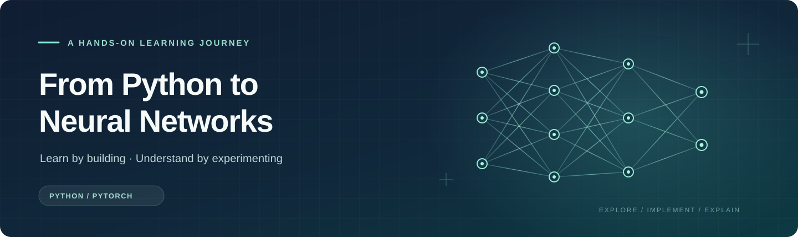

<div align="center">



**从一行 Python 出发，亲手搭建、训练并理解神经网络。**

[English](README.en.md) &nbsp; · &nbsp; [开始学习](#开始学习) &nbsp; · &nbsp; [课程目录](#课程目录) &nbsp; · &nbsp; [交互学习室](https://lee-eee-eee.github.io/neural-networks-from-zero/interactive/) &nbsp; · &nbsp; [动手项目](docs/PROJECTS.md)

`20 个 Notebook` &nbsp; `117 道练习` &nbsp; `18 节交互实验` &nbsp; `Python 3.12 · PyTorch`

</div>

---

一张手写数字为什么能被网络识别？一个模型如何从前面的字符预测下一个字符？一条边的权重发生变化，又会怎样影响最终的结果？

这套课程从可计算、可观察的小例子开始，把 Python、数学推导、模型实现与实验连接起来。你会先手算一个结果，再用 NumPy 或 PyTorch 实现它，最后改变条件，观察模型为什么表现不同。

> **学习方式：** 预测结果 → 运行代码 → 检查中间量 → 动手修改 → 解释现象。

## 你将获得什么

| 从这里出发 | 一路实践 | 最终能做什么 |
| :--- | :--- | :--- |
| **编程与数学基础** | Python、数组形状、矩阵乘法、导数和链式法则 | 读懂数据在程序中的表示，手写并检查一个小网络的梯度 |
| **模型与训练** | PyTorch、训练循环、MLP、CNN、RNN/LSTM | 从数据和损失函数出发，训练模型并分析训练结果 |
| **注意力与生成** | Q/K/V、因果遮罩、Transformer、字符 GPT | 组装一个微型生成模型，并沿张量流阅读 minGPT 源码 |
| **图与连续时间** | 消息传递、GCN、神经动力学与 LTC | 理解图结构和时间步长如何影响状态更新 |
| **实验与评价** | 基线、数据划分、多随机种子、混淆矩阵与阈值 | 设计可比较的实验，报告结果并解释错例 |

每节 Notebook 都围绕具体问题展开，包含讲解、可执行代码与练习；需要时可以展开提示和参考答案。浏览器实验室让你在回到代码前，先观察权重、梯度、卷积窗口和残差路径。

## 适合谁学

- **刚开始学 AI：** 从第 00 课开始，顺着 Python、数组和导数走到第一个可训练网络。
- **会写 Python，想真正弄懂模型：** 从 [03 NumPy 与线性代数](lessons/03_numpy_shapes_linear_algebra.ipynb) 或 [04 手写反向传播](lessons/04_derivatives_numpy_mlp.ipynb)进入，跳过已熟悉的编程基础。
- **已经训练过模型，想理解原理与研究过程：** 根据兴趣选择 CNN、序列、Transformer、GNN 或 LTC 分支，再用 [18 研究实验](lessons/18_research_experiments.ipynb)和[19 分类评价](lessons/19_evaluation_and_decisions.ipynb)组织自己的实验。

课程从基础概念讲起；已有 Python 和微积分经验会帮助你更快推进。Notebook 正文以中文为主；英文课程导航见 [English README](README.en.md)，[项目指南](docs/PROJECTS.md)和[术语速查](docs/REFERENCE.md)提供中英双语。

## 学习路线

```text
                         从这里开始
                              │
       00–03  Python · 函数 · NumPy · 线性代数
                              │
       04–07  导数 · 反向传播 · PyTorch · 训练
                              │
           ┌──────────┬───────┼─────────┬──────────┐
           ↓          ↓       ↓         ↓          ↓
        08–09      10–11   12–15       16         17
        图像        序列    注意力/GPT   图网络      连续时间
           └──────────┴───────┼─────────┴──────────┘
                              ↓
                  18 研究实验 · 19 分类评价
                              ↓
                     选择一个动手项目
```

**建议顺序：** 首次学习先完成 00–07，再根据兴趣选择分支；第 18 课可在完成任一模型分支后学习，第 19 课在完成第 07 课后即可开始。完成每个阶段时，试着独立回答下列问题：

1. **基础：** 我能否解释一个数组的各个轴，并手算一个权重对损失的影响？
2. **模型：** 我能否追踪一次前向计算，说明参数怎样被更新？
3. **实验：** 我能否说明基线、数据划分、评价指标和一次失败案例？

## 开始学习

### 1. 获取课程

安装 [Git](https://git-scm.com/downloads) 和 [uv](https://docs.astral.sh/uv/getting-started/installation/)，然后在终端运行：

```bash
git clone https://github.com/Lee-Eee-Eee/neural-networks-from-zero.git
cd neural-networks-from-zero
```

如果已经有本项目的本地副本，直接在终端进入项目文件夹即可。

### 2. 创建环境并启动 Jupyter

```bash
uv sync --locked
uv run jupyter lab
```

`uv` 会根据项目配置创建隔离环境并安装依赖。课程使用 **Python 3.12** 与 CPU 版 PyTorch；首次安装需要下载依赖。进入 JupyterLab 后，打开 `lessons/00_start_and_environment.ipynb`，选择项目环境对应的 Python 内核。

| 系统 | 项目环境中的 Python |
| :--- | :--- |
| Windows | `.venv\Scripts\python.exe` |
| macOS / Linux | `.venv/bin/python` |

可用下面的命令确认当前项目使用的解释器：

```bash
uv run python -c "import sys; print(sys.executable)"
```

课程使用本地合成数据、scikit-learn 自带的手写数字数据和课程小语料，基础练习不需要下载大型数据集或配置 GPU。第 09 课使用 1,797 张 8×8 数字图像；第 14 课用 27 条合成短句进行字符级训练、验证和测试。

### 3. 完成第一节课

1. 打开 [00 从这里开始](lessons/00_start_and_environment.ipynb)，按顺序运行代码格。
2. 在输出出现之前先预测结果，再修改一个数值，观察结果如何变化。
3. 在练习格中填写答案，运行紧随其后的检查格；遇到困难时展开提示和参考答案。
4. 打开[交互学习室](https://lee-eee-eee.github.io/neural-networks-from-zero/interactive/)，改变一条连接的权重，再回到 Notebook 解释变化。

## 课程目录

### 01 · Python、数学与训练基础

| 课 | 主题 | 本课动手完成 |
| :---: | :--- | :--- |
| [00](lessons/00_start_and_environment.ipynb) | 开始与环境 | 运行第一个程序，认识练习和学习路线 |
| [01](lessons/01_python_values_control.ipynb) | Python 值与控制流 | 用变量、容器、条件和循环处理一组测量值 |
| [02](lessons/02_python_functions_files_classes.ipynb) | 函数、文件与类 | 封装计算、读写数据，并构建最小模型类 |
| [03](lessons/03_numpy_shapes_linear_algebra.ipynb) | NumPy 与线性代数 | 用数组轴、广播和矩阵乘法表达批量计算 |
| [04](lessons/04_derivatives_numpy_mlp.ipynb) | 导数与手写 MLP | 推导反向传播，用 NumPy 训练 XOR 网络 |
| [05](lessons/05_torch_tensors_autograd.ipynb) | Tensor 与 autograd | 追踪计算图，比较手算梯度与自动求导 |
| [06](lessons/06_modules_data_training.ipynb) | 模型、数据与训练循环 | 连接 batch、损失、反传和参数更新 |
| [07](lessons/07_mlp_regression_classification.ipynb) | 回归与分类 | 比较基线与 MLP，练习标准化和验证 |

### 02 · 从模型结构到应用

| 课 | 主题 | 本课动手完成 |
| :---: | :--- | :--- |
| [08](lessons/08_convolution_from_windows.ipynb) | 滑动窗口与卷积 | 手算卷积输出，理解局部连接与权重共享 |
| [09](lessons/09_cnn_training_and_residuals.ipynb) | CNN 与残差 | 训练手写数字分类器，追踪张量形状和梯度 |
| [10](lessons/10_rnn_time_and_bptt.ipynb) | RNN 与时间反传 | 展开状态递推，累加共享参数的时间梯度 |
| [11](lessons/11_lstm_gates_and_memory.ipynb) | LSTM | 手写门控单元，与 PyTorch 对照并训练记忆任务 |
| [12](lessons/12_attention_qkv.ipynb) | Q、K、V 与因果注意力 | 手算注意力权重，并检验未来信息遮罩 |
| [13](lessons/13_transformer_block.ipynb) | Transformer 组件 | 连接多头注意力、归一化、前馈网络和残差 |
| [14](lessons/14_small_gpt_training.ipynb) | 微型字符 GPT | 构造下一字符目标，训练、生成并保存模型 |
| [15](lessons/15_mingpt_reading_and_generation.ipynb) | 阅读 minGPT | 沿真实源码追踪模型结构、张量和训练过程 |
| [16](lessons/16_gnn_message_passing.ipynb) | 图神经网络 | 手算邻居聚合，验证置换等变并训练 GCN |
| [17](lessons/17_liquid_neural_networks.ipynb) | 液体神经网络 | 从连续时间方程和步长构建可训练 LTC 单元 |

### 03 · 从训练模型到解释结果

| 课 | 主题 | 本课动手完成 |
| :---: | :--- | :--- |
| [18](lessons/18_research_experiments.ipynb) | 研究实验 | 设置对照与多随机种子，用验证集选择并分析外推 |
| [19](lessons/19_evaluation_and_decisions.ipynb) | 分类评价与决策 | 比较精确率和召回率，在验证集选阈值并检查泄漏 |

## 交互学习室

<div align="center">

**[在线打开交互学习室 →](https://lee-eee-eee.github.io/neural-networks-from-zero/interactive/)**

</div>

实验在浏览器中计算。点选节点或修改参数，即可观察当前数值、梯度或模型行为；学习完一个概念，再回到对应 Notebook 自己实现。

| 学习到这里 | 打开实验 | 观察什么 |
| :--- | :--- | :--- |
| 04：网络前向 | [读图与计算](interactive/index.html#network) | 节点如何组合输入、权重与偏置 |
| 04–05：反向传播 | [沿边回传](interactive/index.html#backprop) | 梯度如何沿计算路径传播和相加 |
| 06：批量训练 | [共用权重](interactive/index.html#matrix) | 多个样本的梯度如何汇合 |
| 07：分类 | [真实训练](interactive/index.html#training) | 训练过程中的损失与决策边界 |
| 08：卷积 | [窗口与共享核](interactive/index.html#convolution) | 一个输出对应哪些输入像素 |
| 09、13：残差 | [两条支路](interactive/index.html#residual) | 加法节点处的前向和反向路径 |

离线时可打开 [interactive/index.html](interactive/index.html)；也提供[单文件版](interactive/neural-network-lab.html)。

## 把知识连成项目

完成基础课程后，从[双语项目指南](docs/PROJECTS.md)中选择一条路线，记录问题、配置、基线、结果和解释。

| 项目 | 核心问题 | 对应课程 |
| :--- | :--- | :--- |
| **识别数字** | MLP 和 CNN 会在哪些样本上出错？ | 03、06–09 |
| **筛选稀有事件** | 高准确率能否说明模型找到了少见正例？ | 07、18–19 |
| **预测字符** | 上下文长度如何影响预测和生成？ | 12–14 |
| **图上的邻居** | 节点重编号或改变边，会怎样影响 GCN 输出？ | 03、16、18 |

阅读公式或排查代码时，可随手查阅[双语术语与形状速查](docs/REFERENCE.md)。

## 常见问题

<details>
<summary><strong>找不到课程的 Python 内核怎么办？</strong></summary>

先在项目根目录运行 `uv sync --locked` 和 `uv run jupyter lab`，再检查 Notebook 右上角选择的内核。运行 `uv run python -c "import sys; print(sys.executable)"` 可查看项目环境使用的解释器；若编辑器支持按路径选择解释器，请选择该路径。

</details>

<details>
<summary><strong>运行代码时出现 NameError 或结果与预期不同？</strong></summary>

Notebook 的后续代码格可能依赖前面建立的变量。重启内核后从第一格开始依次运行；完成练习时，先运行填写答案的代码格，再运行紧随其后的检查格。

</details>

<details>
<summary><strong>练习的提示和答案在哪里？</strong></summary>

练习与检查格之后有可展开的提示和参考答案。建议先独立尝试，再使用提示；检查结果也会指出哪些值还需要修改。

</details>

<details>
<summary><strong>需要 GPU 或大型数据集吗？</strong></summary>

课程默认使用 CPU 版 PyTorch，基础实验使用合成数据、scikit-learn 自带的 digits 数据和课程小语料。首次同步环境需要网络，训练速度会因设备不同而变化。

</details>

## 仓库结构与维护

```text
neural_networks_from_zero/
├── lessons/            # 20 个课程 Notebook 和练习
├── interactive/        # 浏览器交互实验与单文件版本
├── models/             # 课程复用的微型 GPT
├── docs/               # 双语项目指南、速查与文档资源
├── references/         # 阅读资料、来源说明与 minGPT 快照
├── tools/chapters/     # Notebook 内容的生成源
├── support.py          # 练习反馈与绘图辅助
├── course_manifest.json
├── pyproject.toml
└── uv.lock
```

<details>
<summary><strong>运行与维护命令</strong></summary>

在项目根目录执行：

```bash
# 检查 Notebook 结构、练习和本地链接
uv run python tools/validate_course.py

# 检查浏览器实验中的数值计算（需要 Node.js）
node tools/check_interactive.cjs

# 运行指定课程并写回该 Notebook 的输出
uv run python -B tools/execute_course.py --pattern '01*.ipynb' --jobs 1

# 验证指定课程的参考答案，结果保存在 .build/
uv run python -B tools/execute_course.py --answers --pattern '01*.ipynb' --jobs 1
```

运行 `uv run python tools/build_course.py` 可从 `tools/chapters/` 重建 Notebook。生成器会保留已填写的练习代码，但会重建课程文字和其他代码格；修改课程内容时请编辑生成源。

</details>

更多原论文、官方文档与阅读任务见[参考地图](references/SOURCES.md)和[教学参考](references/TEACHING_NOTES.md)；仓库内第三方材料及其许可证见[第三方说明](THIRD_PARTY.md)。

## 致谢

感谢以下项目、教程与研究工作为本课程的组织、实现和延伸阅读提供的启发：

- [Build Your Own X: Machine Learning](https://github.com/amitshekhariitbhu/build-your-own-x-machine-learning)——从零实现的项目索引，为课程项目练习的组织提供参考。
- [micrograd](https://github.com/karpathy/micrograd) 与 [minGPT](https://github.com/karpathy/minGPT)——分别以紧凑的自动求导和 GPT 实现，帮助读者理解计算图与生成模型；第 15 课使用了仓库内保留许可证的 minGPT 源码快照。
- [动手学深度学习](https://github.com/d2l-ai/d2l-zh)与 [Machine Learning with PyTorch and Scikit-Learn](https://github.com/rasbt/machine-learning-book)——为公式、代码、数据处理和模型评价相结合的学习方式提供参考。
- [PyTorch 官方教程](https://docs.pytorch.org/tutorials/)与 [scikit-learn 文档](https://scikit-learn.org/stable/)——为框架接口、训练流程和评价方法提供可靠资料。
- [Attention Is All You Need](https://arxiv.org/abs/1706.03762)、[GCN](https://arxiv.org/abs/1609.02907)、[Liquid Time-constant Networks](https://arxiv.org/abs/2006.04439) 等论文的作者，以及 [MathJax](https://www.mathjax.org/) 的开发者——让课程中的模型阅读和数学展示成为可能。

也感谢每一位分享知识、开源代码和教学材料的作者，以及使用这套课程、提出建议的学习者。
